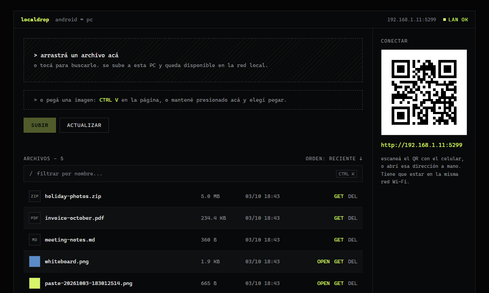

# LocalDrop

A small file drop for moving files and images between an Android phone and a Windows PC on the same Wi-Fi, with no cloud, no account and no app to install on the phone. The PC runs an ASP.NET Core minimal API as a Windows service; the phone just opens a web page by scanning a QR code. Files can be uploaded, downloaded, previewed and deleted from either side, and an image can be pasted straight from the clipboard to share it.



> The UI is in Spanish because it is a tool I use every day and that is the language I think in. Code, comments and docs are in English. Uploaded files and early design mockups are deliberately not in the repo.

## The problem

I kept moving screenshots, PDFs and photos between my phone and my PC several times a day. Every option had friction: messaging myself through a chat app recompresses images, cloud drives need a sync round trip and an account, and USB means finding a cable. Both devices sit on the same network, so the file only needs to cross one room. I wanted something that is always on, opens from the phone in one scan, and keeps the files on my own disk.

## Features

- **Upload and download in both directions.** Drag and drop or pick a file on the PC, or tap to choose one on the phone. Every file is listed with size and date, filterable by name (`Ctrl+K`).
- **Paste to share.** `Ctrl+V` anywhere on the page, or a long-press on the paste zone on the phone, uploads the clipboard image right away, with no file picker and no extra button.
- **Image preview with copy.** Images get a thumbnail and an `OPEN` action that shows them in a modal, with a button to copy the image to the clipboard.
- **QR to connect.** The page shows a QR code with the PC's LAN address, so the phone gets there with one scan.
- **Always available.** The server runs as a Windows service that starts with the machine and restarts itself on failure.

## Design decisions

**A web page instead of an Android app.** The phone already has a browser, and a page served by the PC is always the latest version. There is nothing to install, update or sign on the phone, and the same UI works from any other device on the network.

**Kestrel as a Windows service instead of IIS.** The first version was hosted in IIS. Running Kestrel directly through `UseWindowsService()` removed the IIS dependency and its configuration, and gave automatic restart through the service recovery options. `deploy/uninstall-service.cmd` restores the IIS site if I ever need to roll back.

**Plain HTML and JavaScript, no frontend framework.** The whole UI is one `index.html` with inline CSS and JS. For a single screen with a list and a few buttons, a build step would cost more than it gives.

**The LAN address is resolved on the server.** The QR and the address shown in the page come from the server, which opens a UDP socket towards a public address without sending anything and reads which local interface the OS picked. That picks the real LAN adapter instead of a VPN or virtual switch. The QR is served with `Cache-Control: no-store` because DHCP can change the address.

**Pasted images get a timestamped name.** Clipboard images almost always arrive as `image.png`, and uploads with an existing name overwrite the old file. Every paste is saved as `paste-YYYYMMDD-HHMMSSmmm.png` so two pastes never collide.

**Images are copied as PNG.** Browsers only reliably accept `image/png` in the clipboard, so the copy button re-encodes any image through a canvas before writing it.

## Architecture

```text
Android browser / any LAN device
        │  HTTP
        ▼
LocalDrop.Api (ASP.NET Core minimal API on Kestrel, Windows service)
        │
        ▼
Storage folder on the PC's disk
```

```text
LocalDrop.Api/
├── Program.cs           # Endpoints, storage, QR and LAN address resolution
├── wwwroot/index.html   # The entire UI
├── appsettings.json     # Listen URL and storage path
└── deploy/              # Publish, install and uninstall the Windows service
```

| Endpoint | Purpose |
|---|---|
| `GET /health` | Health check |
| `GET /api/netinfo` | LAN IP and port of the server |
| `GET /api/qr` | PNG QR code with the server address |
| `GET /api/files` | List files, newest first |
| `POST /api/files/upload` | Upload (`multipart/form-data`, field `file`) |
| `GET /api/files/{fileName}` | Download |
| `DELETE /api/files/{fileName}` | Delete |

## Getting started

Requirements: Windows, the .NET 10 SDK, and the phone on the same network as the PC.

```powershell
cd LocalDrop.Api
dotnet run
```

Then open `http://<pc-ip>:5001` from the phone, or scan the QR shown on the PC.

Both settings in `appsettings.json` can be overridden with environment variables of the same name:

- `LOCALDROP_URLS`: listen address, `http://0.0.0.0:5001` by default in `appsettings.json`.
- `LOCALDROP_STORAGE_PATH`: where uploaded files are stored. It falls back to a `Storage` folder next to the executable.

The first run may need an inbound Windows Firewall rule for the port.

### Run as a Windows service

From an elevated prompt:

```powershell
# Publish to the deploy folder and register the service
dotnet publish LocalDrop.Api -c Release -o C:\Proyectos\LocalDropServer
LocalDrop.Api\deploy\install-service.cmd

# Later updates: stops the service, publishes, starts it again
LocalDrop.Api\deploy\publish.cmd
```

The service locks its binaries while it runs, so `publish.cmd` stops it first and restarts the previous version if the publish fails.

## Known limitations

- **No authentication.** Anyone on the same network can list, download and delete files. It is meant for a trusted home network only.
- **Plain HTTP.** Traffic is not encrypted. Because of that, browsers block the Clipboard API on the phone, so the copy button only works on the PC itself (`localhost`). On the phone, a long-press on the image offers the browser's own "Copy image".
- **Upload size limit.** Kestrel's default request limit cuts uploads at about 30 MB; larger files get a `413`.
- **No upload progress.** Uploads use `fetch`, which does not report progress.
- **Same name overwrites.** Uploading a file with an existing name replaces the old one.

## License

[MIT](LICENSE)
